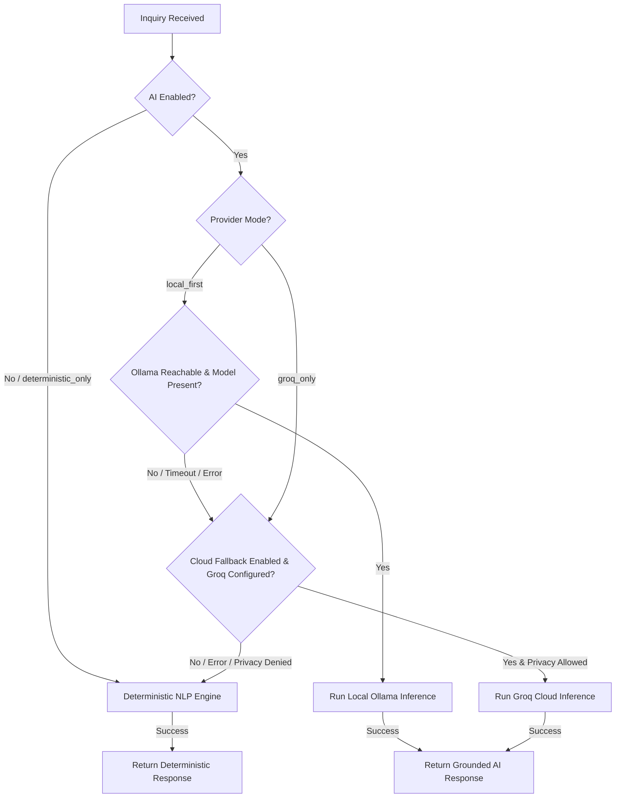

# ResearchLens — Collaborator AI Setup & Architecture Guide
**Local-First Intelligence • Groq Cloud Failover • Deterministic Baseline**

This guide documents how collaborators can work with ResearchLens in three supported operational environments without modifying application source code, sharing API keys, or risking research privacy.

---

## The Three Operating Environments

ResearchLens is designed to function seamlessly across three distinct operating modes:

| Environment | When to Use | Requirements | AI Provider |
| :--- | :--- | :--- | :--- |
| **Environment A: Local AI** | Personal dev machine with Ollama installed | Ollama running (`127.0.0.1:11434`) + Qwen 2.5 3B / Llama 3.2 3B | `ollama` (Local) |
| **Environment B: Collaborator Cloud AI** | Teammate without local Ollama / laptop GPU | Personal Groq API Key | `groq` (Cloud Failover) |
| **Environment C: Zero-AI / Pure Offline** | Default out-of-the-box, CI/CD, or air-gapped dev | None (uses local FAISS + SPECTER2 + NLP rules) | `deterministic` |

The core research discovery platform (semantic search, paper comparison, citation extraction, PDF catalog ingestion, and DRIUT scheduling) **always** works in Environment C. AI enhancement is purely additive and never a single point of failure.

---

## 1. Environment C: Running ResearchLens Without AI (Default)

By default, ResearchLens runs with AI generation disabled:
```env
RESEARCHLENS_AI_ENABLED=false
```
In this mode:
- Assistant queries synthesize claims and evidence deterministically from catalog text with exact character spans.
- Multi-paper comparisons, summaries, and gap explorers run through deterministic NLP extraction.
- Zero network requests are made to external LLM services.
- Zero local LLM memory or VRAM is allocated.

To explicitly force deterministic operation even if models or keys are configured:
```env
RESEARCHLENS_AI_PROVIDER=deterministic_only
```

---

## 2. Environment A: Configuring Local Ollama AI

If you have a local machine with sufficient RAM/GPU (e.g., 4+ GB VRAM or 8+ GB RAM) and want 100% private local inference:

### Step 1: Install Ollama
Download and install Ollama from [ollama.com](https://ollama.com) or your package manager:
```bash
# Verify installation
ollama --version
```

### Step 2: Pull the Recommended Lightweight Model
ResearchLens recommends **Qwen 2.5 3B** or **Llama 3.2 3B** for optimal balance of reasoning quality and low memory footprint (~2.0 GB storage, ~2.5 GB RAM/VRAM):
```bash
ollama pull qwen2.5:3b
# or: ollama pull llama3.2:3b
```

### Step 3: Configure `.env`
In your local `.env` file (never commit this file):
```env
RESEARCHLENS_AI_ENABLED=true
RESEARCHLENS_AI_PROVIDER=local_first
RESEARCHLENS_OLLAMA_BASE_URL=http://127.0.0.1:11434
RESEARCHLENS_OLLAMA_MODEL=qwen2.5:3b
RESEARCHLENS_AI_CLOUD_FALLBACK=true
```

When you start the backend, ResearchLens will automatically route queries to your local model.

---

## 3. Environment B: Collaborator Cloud AI via Personal Groq Key

If your development machine lacks the RAM/GPU for Ollama, you can configure your own personal free Groq API key:

### Step 1: Obtain a Free Groq API Key
1. Go to [console.groq.com](https://console.groq.com).
2. Generate a personal API key (starts with `gsk_...`).
3. **NEVER share your key with teammates or commit it to Git.**

### Step 2: Configure Local `.env`
Add your key to your local `.env`:
```env
RESEARCHLENS_AI_ENABLED=true
RESEARCHLENS_AI_PROVIDER=local_first   # or groq_only
RESEARCHLENS_AI_CLOUD_FALLBACK=true
GROQ_API_KEY=gsk_your_personal_key_here
RESEARCHLENS_GROQ_MODEL=llama-3.3-70b-versatile
RESEARCHLENS_ALLOW_CLOUD_RESEARCH_CONTENT=true
```

### Important Privacy Control: Cloud Transmission Consent
```env
RESEARCHLENS_ALLOW_CLOUD_RESEARCH_CONTENT=true
```
- When set to `false` (default): ResearchLens **blocks** sending private uploaded PDF texts, notes, and catalog passages to the cloud. If Ollama is unavailable, the system safely falls back to the local deterministic engine rather than leaking data to third-party cloud APIs.
- When set to `true`: The user explicitly consents to transmitting bounded research passages to Groq for synthesis.

---

## 4. Provider Selection Policy & Automatic Failover

The provider coordinator follows a deterministic, fail-safe hierarchy:



### Fail-Safe Guarantees
1. **Bounded Timeouts:** Ollama and Groq calls time out after `RESEARCHLENS_AI_TIMEOUT_SECONDS` (default: 15s) and immediately trigger failover.
2. **Never Stalls:** A provider error or missing service never hangs an HTTP connection.
3. **Never Fabricates:** When retrieved evidence is insufficient (`status: "insufficient_evidence"`), the system returns an explicit insufficiency notice rather than querying an LLM to invent findings.

---

## 5. Safe Inspection & Status Verification (Zero Secrets Leaked)

To inspect active provider health without revealing API keys:

### Via API:
```bash
curl -s http://localhost:8000/api/v1/research/ai/status | jq .
```
Example Output:
```json
{
  "ai_enabled": true,
  "configured_mode": "local_first",
  "active_provider": "deterministic",
  "ollama_available": false,
  "ollama_model": "qwen2.5:3b",
  "ollama_endpoint": "http://127.0.0.1:11434",
  "groq_configured": false,
  "groq_available": false,
  "groq_model": "llama-3.3-70b-versatile",
  "cloud_fallback_enabled": true,
  "cloud_privacy_allowed": false,
  "deterministic_fallback_active": true,
  "timeout_seconds": 15.0,
  "max_output_tokens": 1024
}
```

### Via Frontend UI:
The Research Assistant sub-tab in the Research Evolution view displays a live status indicator pill:
- `🤖 AI: OLLAMA (qwen2.5:3b)` — Local inference active.
- `⚡ AI: GROQ (llama-3.3-70b-versatile)` — Cloud failover active.
- `🛡️ AI: DETERMINISTIC (Fallback Active)` — Safe local fallback active.

Every response card displays the handling provider, failover flag, and inference latency in milliseconds.

---

## 6. Running Tests Without Live Credentials

The entire test suite runs with isolated test fixtures and zero live credentials:
```bash
# Backend AI Provider & Coordinator Tests (13 tests)
cd backend
./venv/bin/pytest tests/test_ai_providers.py -v

# Backend Grounded Assistant Tests (10 tests)
./venv/bin/pytest tests/test_research_assistant.py -v

# Frontend Vitest Suite (63 tests)
cd frontend
npm test

# Frontend Production Build
npm run build
```

---

## 7. Troubleshooting Common Collaborator Issues

| Issue | Cause | Resolution |
| :--- | :--- | :--- |
| **"Deterministic Fallback Active" displayed** | Ollama is not running and `GROQ_API_KEY` is not set | Expected behavior! Start Ollama (`ollama serve`) or configure a personal Groq key in `.env`. |
| **"Cloud research transmission not consented"** | `RESEARCHLENS_ALLOW_CLOUD_RESEARCH_CONTENT` is set to `false` | If you wish to use Groq for research synthesis, set `RESEARCHLENS_ALLOW_CLOUD_RESEARCH_CONTENT=true` in your `.env`. |
| **Groq 401 Unauthorized** | Expired or incorrect `GROQ_API_KEY` | Generate a new key from [console.groq.com](https://console.groq.com) and update `.env`. |
| **Groq 429 Rate Limit** | Free tier RPM/TPM limit hit | ResearchLens automatically falls back to deterministic NLP. Wait 60s or switch to local Ollama. |
| **Ollama connection timeout** | Heavy load or cold model loading | Increase `RESEARCHLENS_AI_TIMEOUT_SECONDS=30.0` or run a smaller quantized model (`qwen2.5:1.5b`). |
