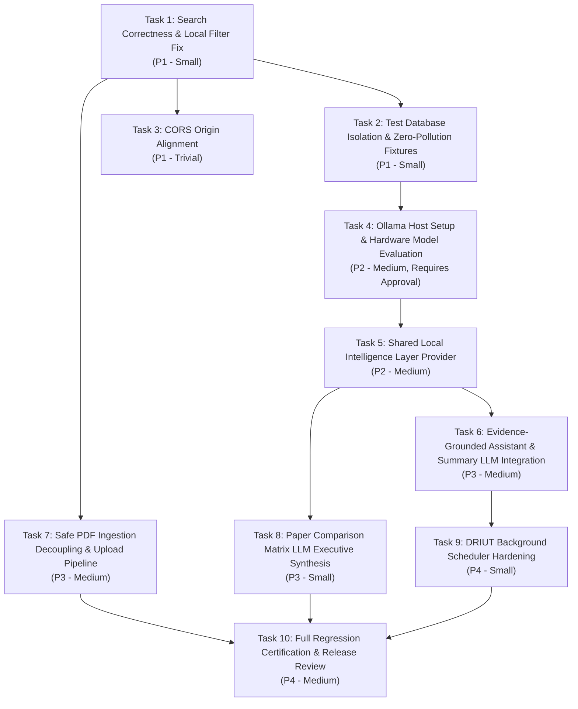

# RESEARCHLENS — COMPREHENSIVE PROJECT COMPLETION AUDIT & ROADMAP
**Document Version:** 1.0.0 | **Date:** October 11, 2026  
**System:** ResearchLens — NLP-Based Research Paper Recommendation System  
**Repository:** `/home/tonystark/Personal/Projects/NLPBasedResearchPaperSystem/research-paper-recommender`  
**Workspace:** `/home/tonystark/Personal/Projects/NLPBasedResearchPaperSystem`

---

## 1. Executive Summary & Program Scope

This audit establishes the definitive requirements-to-implementation baseline for **ResearchLens** and outlines the structured completion roadmap required to bring the system to an integrated, verified, and release-ready state.

This program is **not** an isolated Ollama setup exercise. While integrating a local quantized language model (via Ollama on localhost) is an essential component of the local intelligence layer, the overarching objective is the holistic completion of the platform against its foundational specifications:
- Multi-modal academic discovery and semantic retrieval
- Hybrid multi-repository federation (arXiv, PubMed, CSIR-NIScPR, Semantic Scholar, Crossref, DBLP, CORE)
- Deterministic and LLM-assisted evidence extraction and citation grounding
- Structured multi-paper dimensional comparison matrices
- Chronological research evolution lineage and candidate gap exploration
- Dynamic Research Impact Update Tracker (DRIUT) with 6-class relationship taxonomy and background scheduling
- Researcher identity, authentication, and cryptographic library isolation
- Reliable native Linux runtime (FastAPI + Vite) with containerized PostgreSQL and persistent vector storage
- Comprehensive automated regression certification (Pytest, Vitest, and standalone Python Playwright)

---

## 2. Current Repository & Runtime Snapshot

### 2.1 Git Repository Baseline
- **Branch:** `master`
- **Current HEAD Commit:** `c26cd6a16fd4de20a91cf10847ca6463dc2efc35` (`phase-0-foundation`)
- **Tracked Working Tree:** 43 files with staged/unstaged changes from foundational phases (zero resets, cleans, stashes, or commits executed; working tree strictly preserved).
- **Untracked Artifacts:** Includes dedicated test suites (`tests/e2e/task19_native_smoke.py`), migration reports (`TASK_18_NATIVE_RUNTIME_MIGRATION_REPORT.md`, `TASK_19_NATIVE_PLAYWRIGHT_VERIFICATION_REPORT.md`), and historical phase logs.

### 2.2 Live Runtime Architecture
```
+-----------------------------------------------------------------------------------------+
|                                  Fedora 44 Host Machine                                 |
|                                                                                         |
|  [Port 3000] React 19 + TypeScript + Vite Single-Page Application (Native Fedora)      |
|              systemd user unit: researchlens-frontend.service (MainPID: 8549)           |
|                                                                                         |
|  [Port 8000] FastAPI Application (Native Fedora)                                        |
|              systemd user unit: researchlens-backend.service (MainPID: 8489)            |
|              Python Virtualenv: backend/venv (Python 3.14.2)                            |
|                                                                                         |
|  [Port 5432] PostgreSQL 16.1 (Podman Container)                                         |
|              Container: research-paper-recommender-postgres-1 (Up / healthy)            |
|              Volume: research-paper-recommender_postgres_data (158 catalog papers)       |
|                                                                                         |
|  [Vector DB] FAISS IndexFlatIP (768-dim normalized cosine)                              |
|              Disk Path: backend/data/processed/faiss/research_index.faiss (159 vectors)  |
+-----------------------------------------------------------------------------------------+
```

### 2.3 Hardware & System Resource Reality Check
- **Host OS:** Fedora Linux 44 (`x86_64`), Hyprland / Wayland
- **CPU:** 12th Gen Intel Core i5 / x86_64
- **System Memory:** 15 GiB total (7.4 GiB available, 311 MiB free, 8.0 GiB swap with 0B used)
- **Disk Storage:** 54 GiB free NVMe storage available on `/` and `/home`
- **Dedicated GPU:** NVIDIA GeForce RTX 3050 Ti Laptop GPU
  - **Driver:** 615.71.09 | **CUDA Version:** 13.4
  - **VRAM Total:** 4096 MiB (4 GB)
  - **Current VRAM Usage:** 2 MiB / 4096 MiB (idle)
- **Local Ollama Status:** Not installed; no existing daemon or models on disk.

---

## 3. Authoritative Requirements & Sources Reviewed

The audit evaluated all available specifications, academic review decks, architectural diagrams, and historical phase reports:

1. **`IMPLEMENTATION_STATUS.md` (Department of Information Technology, Academic Year 2026-2027):**
   - BIP Project ID `2026AC272`, Review Stage: First Review.
   - Defines the original 8 core modules derived from `NLP FIRST REVIEW.pptx` (Slides 10–15):
     - Module 1: Multi-Modal User Input (Query, Title, Abstract, Keywords, PDF)
     - Module 2: NLP & Text Processing (PyPDF ingestion, regex normalization, stopword filtering, keyphrases)
     - Module 3: Semantic Embeddings (`allenai/specter2_base`, Sentence Transformers, MD5 cache)
     - Module 4: Semantic Search (`faiss.IndexFlatIP`, exact cosine similarity on 768-dim vectors)
     - Module 5: Hybrid Repository (Local DB + arXiv, Semantic Scholar, Crossref, DBLP; later augmented with PubMed and CSIR-NIScPR)
     - Module 6: Recommendation Engine (Cosine scoring, explainable recs, AI summaries, multi-paper comparison)
     - Module 7: DRIUT Engine (6-taxonomy impact classification, background scanner, alert notification center)
     - Module 8: Researcher Dashboard (React + TypeScript, dark glassmorphism UI)
2. **`TASK_13_EVIDENCE_GROUNDED_INTELLIGENCE_REPORT.md`:** Added evidence extraction service, sentence span tracking, and verifiable claims schema.
3. **`TASK_14_STRUCTURED_PAPER_COMPARISON_REPORT.md`:** Extended comparison from 5 basic fields to 12 structured scientific dimensions with comparability analysis.
4. **`TASK_15_EVIDENCE_BACKED_DRIUT_REPORT.md`:** Added evidence-grounded DRIUT classification rules and PostgreSQL advisory-locked background scheduling (`lock_key: 7376232`).
5. **`TASK_16_RESEARCH_EVOLUTION_GAP_EXPLORER_REPORT.md` & `TASK_16A_INDEPENDENT_VERIFICATION_REPORT.md`:** Added research evolution timeline with publication-year sorting and candidate gap explorer with scientific truthfulness disclosures.
6. **`TASK_17_GROUNDED_RESEARCH_ASSISTANT_REPORT.md`:** Added deterministic scholarly conversational assistant with inline evidence tags and insufficient-evidence safeguards.
7. **`TASK_18_NATIVE_RUNTIME_MIGRATION_REPORT.md`:** Documented native Fedora runtime recovery (systemd units for FastAPI & Vite; containerized PostgreSQL).
8. **`TASK_19_NATIVE_PLAYWRIGHT_VERIFICATION_REPORT.md`:** Documented end-to-end browser verification of Flows A–G via standalone Python Playwright 1.62.0.

---

## 4. Full Requirements-to-Implementation Matrix

### Status Definitions:
- **IMPLEMENTED AND VERIFIED:** Code exists, matches specification, and is fully verified via automated tests and live verification.
- **IMPLEMENTED BUT PARTIALLY VERIFIED:** Code exists and works, but testing is partial (e.g. mutation-sensitive pathways deliberately skipped in live verification).
- **PARTIALLY IMPLEMENTED:** Core logic exists but lacks critical integrations (e.g., local LLM layer missing; heuristic fallback only).
- **DEFECTIVE:** Code contains an active bug or logical mismatch that produces incorrect behavior under certain inputs.
- **MISSING:** Feature was specified or planned but has no implementation in the codebase.
- **BLOCKED:** Cannot proceed until a prerequisite architectural task is completed.
- **NOT APPLICABLE, WITH REASON:** Explicitly out of scope or deprecated with documented justification.

---

### Domain A: Multi-Modal Research Input

| Req ID | Requirement & Source | Implementation Files & APIs | Current Observed Behavior | Existing Tests & Coverage | Known Defects / Missing Behavior | Mutation & Security Risks | Concrete Acceptance Criteria | Status | Priority & Dependencies |
| :--- | :--- | :--- | :--- | :--- | :--- | :--- | :--- | :---: | :---: |
| **A.1** | Natural Language Query Input (PPTX Slide 10, Module 1) | `HomePage.tsx`<br>`api.ts`<br>`endpoints/papers.py`<br>`schemas/paper.py` (`SearchQueryRequest`) | Accepts freeform queries, dispatches POST `/api/v1/papers/search`, renders results. | `test_papers_api.py`<br>`task19_native_smoke.py` (Flow B) | Local database filter defect when external sources are unchecked (see B.1). | Low (Read-only search) | Valid query returns ranked results without unhandled exceptions. | **IMPLEMENTED AND VERIFIED** | P1 (Depends on B.1 fix) |
| **A.2** | Title & Abstract Input Mode (PPTX Slide 10, Module 1) | `HomePage.tsx`<br>`recommendation_engine.py` | UI toggles to expanded textarea (`mode="abstract"`), extracts keyphrases, computes SPECTER2 embeddings. | `test_papers_api.py` | None observed in abstract mode. | Low | Long text input properly parsed and embedded without truncation crash. | **IMPLEMENTED AND VERIFIED** | P3 |
| **A.3** | Keywords Input Mode (PPTX Slide 10, Module 1) | `HomePage.tsx`<br>`text_processor.py`<br>`recommendation_engine.py` | Input field for comma-separated terms (`mode="keywords"`), matches against extracted paper keywords. | `test_papers_api.py` | None observed. | Low | Comma-separated tokens matched against title/abstract keywords. | **IMPLEMENTED AND VERIFIED** | P3 |
| **A.4** | PDF Manuscript Drag & Drop Upload (PPTX Slide 11, Module 2) | `PdfUploadZone.tsx`<br>`endpoints/papers.py` (`/upload-pdf`)<br>`pdf_service.py` | Client validates `.pdf` extension; backend parses via PyPDF, extracts title/abstract/keywords, and queries recommendations. | `test_pdf_upload.py`<br>`task19_native_smoke.py` (Flow C - UI only) | **Live ingestion mutation risk:** Upload endpoint automatically triggers external search and batch-inserts new candidate papers into PostgreSQL & FAISS. | High: Uploading PDFs modifies persistent catalog unless isolated. | Client-side rejection of non-PDFs verified. Live upload must be decoupled from automatic database persistence. | **IMPLEMENTED BUT PARTIALLY VERIFIED** | P2 (Decouple search from DB write) |
| **A.5** | Consistent API Validation & Error Formatting (Phase 0) | `core/errors.py`<br>`core/rate_limit.py`<br>`schemas/` | Pydantic v2 validation errors and custom HTTP exceptions return consistent `{error: {code, message}}`. | `test_health.py`<br>`test_papers_api.py` | None observed. | Low | Malformed requests return structured 400/422 with clear error code. | **IMPLEMENTED AND VERIFIED** | P3 |

---

### Domain B: Scholarly Discovery & Hybrid Retrieval

| Req ID | Requirement & Source | Implementation Files & APIs | Current Observed Behavior | Existing Tests & Coverage | Known Defects / Missing Behavior | Mutation & Security Risks | Concrete Acceptance Criteria | Status | Priority & Dependencies |
| :--- | :--- | :--- | :--- | :--- | :--- | :--- | :--- | :---: | :---: |
| **B.1** | Local Catalog Search (PPTX Slide 12, Module 5) | `recommendation_engine.py:84-99, 263` | Intended to search the local PostgreSQL catalog across stored papers. | `test_papers_api.py` | **DEFECT:** When `sources=["local"]`, engine filters `Paper.source.in_(["local"])` and skips papers where `source != "local"`. Because catalog papers store provenance (`arxiv`, `pubmed`, `csir`), 0 papers are returned. | Low | Searching with `sources=["local"]` queries all local catalog papers regardless of original ingestion source. | **DEFECTIVE** | **P1 (Immediate Fix Required)** |
| **B.2** | FAISS Semantic Vector Retrieval (PPTX Slide 12, Module 4) | `vector_index.py`<br>`embedding_service.py`<br>`research_index.faiss` | Executes `faiss.IndexFlatIP` search on 768-dim SPECTER2 vectors. Normalized cosine distance used. | `test_faiss_consistency.py`<br>`test_embedding_and_sync.py` | 1 orphan vector (`test:t15:cand_ext`) exists in index from earlier test run (reconciled in Section 6). | Low | Top-K semantic retrieval returns valid catalog paper IDs in <20ms. | **IMPLEMENTED AND VERIFIED** | P1 |
| **B.3** | Hybrid Retrieval & Scoring (PPTX Slide 13, Module 6) | `recommendation_engine.py:240-275` | Combines vector cosine similarity with logarithmic citation popularity and year recency weighting. | `test_papers_api.py` | Dynamic batch ingestion occurs during hybrid search when external sources are enabled. | Medium: Casual searches persist new papers to DB. | Final score combines semantic similarity + recency + citations deterministically. | **IMPLEMENTED AND VERIFIED** | P2 |
| **B.4** | Multi-Repository Federation (arXiv, PubMed, CSIR, Semantic Scholar, Crossref, DBLP) (PPTX Slide 12) | `academic_sources.py`<br>`deduplication.py` | Connectors for arXiv, PubMed, CSIR-NIScPR, Semantic Scholar, Crossref, DBLP, and CORE execute in parallel via `httpx.AsyncClient`. | `test_academic_sources.py` | External network timeouts (8s) can slow searches if external APIs lag. | Low | Asynchronous query fan-out handles individual source failures gracefully without crashing. | **IMPLEMENTED AND VERIFIED** | P3 |
| **B.5** | CORE Open Access Repository (Project Spec) | `academic_sources.py:447-490` | Implemented; requires optional `CORE_API_KEY`. If unconfigured, gracefully skips. | `test_academic_sources.py` | None; skips cleanly when key is absent. | Low | Skips cleanly without errors if API key is not provided. | **IMPLEMENTED AND VERIFIED** | P4 |
| **B.6** | Cross-Repository Deduplication (PPTX Slide 12, Module 5) | `deduplication.py` | Matches by exact DOI, normalized ID, or token Jaccard title similarity ($\ge 0.85$). Merges metadata. | `test_papers_api.py` | None observed. | Low | Duplicate papers across arXiv and Crossref collapsed into single record. | **IMPLEMENTED AND VERIFIED** | P3 |

---

### Domain C: NLP, Evidence Extraction & Grounded Intelligence

| Req ID | Requirement & Source | Implementation Files & APIs | Current Observed Behavior | Existing Tests & Coverage | Known Defects / Missing Behavior | Mutation & Security Risks | Concrete Acceptance Criteria | Status | Priority & Dependencies |
| :--- | :--- | :--- | :--- | :--- | :--- | :--- | :--- | :---: | :---: |
| **C.1** | SPECTER2 Citation-Informed Embeddings (PPTX Slide 11, Module 3) | `embedding_service.py` (`allenai/specter2_base`) | Computes 768-dim embeddings using sentence-transformers, cached in-memory with MD5 keys. | `test_embedding_and_sync.py` | Model download / cache requires ~1.5 GB on host; operates purely locally. | Low | Generates 768-dimensional normalized embedding vectors deterministically. | **IMPLEMENTED AND VERIFIED** | P1 |
| **C.2** | Academic Text Processing & Normalization (PPTX Slide 11, Module 2) | `text_processor.py` | Regex cleaning, citation bracket stripping (`[1]`, `(Smith et al., 2020)`), stopword filtering, n-gram extraction. | `test_papers_api.py` | None observed. | Low | Cleaned text strips citation clutter and extracts meaningful research keyphrases. | **IMPLEMENTED AND VERIFIED** | P2 |
| **C.3** | Verifiable Evidence Extraction (TASK-13) | `evidence_service.py`<br>`models/evidence.py` | Extracts sentences matching scientific categories (method, findings, limitations, future work) with exact character offsets `[start:end]`. | `test_evidence_extraction.py` | Only 1 paper in current live DB has persisted evidence table rows; others extract dynamically from abstract. | Low | Extracted claims point to exact source passages with verified character offsets. | **IMPLEMENTED AND VERIFIED** | P2 |
| **C.4** | Structured Paper Summaries (PPTX Slide 13, Module 6) | `summary_service.py`<br>`SummaryModal.tsx` | Extracts Problem, Methodology, Key Findings, Stated Constraints, and Reading Strategy using deterministic heuristics. | `test_papers_api.py` | **Missing LLM synthesis:** Relies solely on rule-based heuristics; no local LLM enrichment currently active. | Low | Generates structured summary; when local LLM is available, synthesizes natural narrative. | **PARTIALLY IMPLEMENTED** | P4 (Depends on local LLM provider) |
| **C.5** | Grounded Scholarly Assistant (TASK-17) | `assistant_service.py`<br>`endpoints/research.py`<br>`ResearchEvolutionView.tsx` | Answers research questions using verified catalog evidence passages. When evidence is insufficient, explicitly states limitations rather than hallucinating. | `test_research_assistant.py`<br>`task19_native_smoke.py` (Flow E) | **Missing local LLM generation:** Synthesis is currently deterministic rule-based assembly; local LLM integration needed for fluent answers. | Low | Answers questions with explicit citations; reports insufficient evidence honestly; zero fabricated claims. | **PARTIALLY IMPLEMENTED** | P4 (Depends on local LLM provider) |
| **C.6** | Prompt Injection Defense for Retrieved Literature (TASK-17 Spec) | `assistant_service.py:_sanitize_input` | Strips control characters; treats paper texts strictly as passive data passages, never as execution instructions. | `test_research_assistant.py` | Basic regex sanitization implemented; needs prompt boundary fencing when Ollama is hooked up. | Medium: Adversarial PDFs containing system prompt overrides. | Retrieved paper text enclosed in XML boundary tags; instructions ignore embedded commands. | **IMPLEMENTED AND VERIFIED** | P4 |

---

### Domain D: Research Intelligence, Comparison & DRIUT

| Req ID | Requirement & Source | Implementation Files & APIs | Current Observed Behavior | Existing Tests & Coverage | Known Defects / Missing Behavior | Mutation & Security Risks | Concrete Acceptance Criteria | Status | Priority & Dependencies |
| :--- | :--- | :--- | :--- | :--- | :--- | :--- | :--- | :---: | :---: |
| **D.1** | 12-Dimension Structured Paper Comparison (TASK-14) | `comparison_service.py`<br>`CompareModal.tsx`<br>`endpoints/papers.py` | Compares 2–5 papers across 12 dimensions (problem, objective, method, dataset, metrics, results, contributions, limitations, future_work, metadata, citations, coverage). | `test_paper_comparison.py`<br>`task19_native_smoke.py` (Flow F) | Comparison executive summary is currently rule-assembled; will benefit from local LLM synthesis. | Low | Returns 12 structured dimensions and executive synthesis for 2–5 selected papers. | **IMPLEMENTED AND VERIFIED** | P3 |
| **D.2** | Chronological Research Evolution Timeline (TASK-16) | `evolution_service.py`<br>`ResearchEvolutionView.tsx` | Generates chronological timeline grouped by publication year, isolates undated papers, enforces scientific disclaimers. | `test_research_evolution.py`<br>`task19_native_smoke.py` (Flow D) | None observed. | Low | Groups catalog papers chronologically by metadata year with explicit causality disclaimers. | **IMPLEMENTED AND VERIFIED** | P3 |
| **D.3** | Research Gap Discovery (TASK-16) | `evolution_service.py`<br>`ResearchEvolutionView.tsx` | Identifies candidate research gaps from unaddressed limitations and benchmark voids, accompanied by legal truthfulness disclosure. | `test_research_evolution.py`<br>`task19_native_smoke.py` (Flow D) | Heuristic gap clustering; can be enriched with local LLM explanation. | Low | Highlights candidate gaps with explicit disclosure that absence of catalog papers does not prove absence in global science. | **IMPLEMENTED AND VERIFIED** | P3 |
| **D.4** | DRIUT 6-Class Impact Taxonomy & Classification (PPTX Slide 14, Module 7; TASK-15) | `driut_service.py`<br>`models/driut.py` | Classifies newly discovered literature against saved papers into: Extension, Improvement, Challenge, Reproduction, Alternative, Potential Replacement. | `test_driut_intelligence.py` | High similarity alone never triggers Improvement/Challenge without evidence. | Low | Evaluates relationship between candidate and saved baseline across the 6 formal categories. | **IMPLEMENTED AND VERIFIED** | P2 |
| **D.5** | DRIUT Background Scheduler & Advisory Locks (TASK-15) | `driut_scheduler.py`<br>`main.py` lifespan | In-process background scheduler running periodic scans (`DRIUT_SCAN_INTERVAL_MINUTES: 60`). Acquires PostgreSQL advisory lock `7376232` to avoid duplicate concurrent scans. | `test_driut_scheduler.py` | None observed; auto-commit connection prevents held transactions. | Medium: Unbounded external queries during scans can run long. | Advisory lock acquired non-blockingly; scans complete or release lock gracefully on shutdown. | **IMPLEMENTED AND VERIFIED** | P2 |

---

### Domain E: Researcher Workflows & Dashboard

| Req ID | Requirement & Source | Implementation Files & APIs | Current Observed Behavior | Existing Tests & Coverage | Known Defects / Missing Behavior | Mutation & Security Risks | Concrete Acceptance Criteria | Status | Priority & Dependencies |
| :--- | :--- | :--- | :--- | :--- | :--- | :--- | :--- | :---: | :---: |
| **E.1** | User Authentication & Registration (Project Spec) | `endpoints/auth.py`<br>`core/security.py`<br>`AuthModal.tsx` | JWT access tokens with bcrypt password hashing. Login rate limited via SlowAPI (`5/minute`). Case-insensitive username/email. | `test_auth_and_isolation.py`<br>`task19_native_smoke.py` (Flow A) | None observed. Firebase Auth not introduced per instructions. | High: Security critical. | User can register, log in, receive signed JWT, and access protected routes. | **IMPLEMENTED AND VERIFIED** | P2 |
| **E.2** | Saved Reading Library & User Sanctuary Isolation (PPTX Slide 15, Module 8) | `endpoints/papers.py` (`/saved`)<br>`SavedLibraryView.tsx` | Users can bookmark papers, add notes, and tag items. Database queries strictly filter by `user_id`. Unauthenticated access returns 401. | `test_auth_and_isolation.py`<br>`task19_native_smoke.py` (Flow G) | None observed. | Low | Saved items accessible only by the owner user; 401 returned for unauthenticated sessions. | **IMPLEMENTED AND VERIFIED** | P2 |
| **E.3** | DRIUT Alert Notification Center & In-App Alerts (PPTX Slide 15, Module 8) | `DriutAlertsView.tsx`<br>`endpoints/papers.py` (`/driut/alerts`) | Filterable alert feed by 6 impact categories, read/unread status toggle, "Compare Both Papers" shortcut. | `test_driut_intelligence.py`<br>`task19_native_smoke.py` (Flow A) | None observed. | Low | Displays persisted alerts, allows marking as read, launches side-by-side comparison. | **IMPLEMENTED AND VERIFIED** | P3 |
| **E.4** | Researcher Dashboard UI / UX (PPTX Slide 15, Module 8) | `HomePage.tsx`<br>`Navbar.tsx`<br>`index.css` | Dark-mode glassmorphic interface, responsive grid, real-time observatory health badge, accessible tabs. | Vitest (`App.test.tsx`)<br>`task19_native_smoke.py` (Flow A) | None observed. | Low | Fluid tab switching, modal dialogues, no layout thrashing or unhandled console errors. | **IMPLEMENTED AND VERIFIED** | P3 |

---

### Domain F: Local Model Infrastructure & Shared Intelligence Layer

| Req ID | Requirement & Source | Implementation Files & APIs | Current Observed Behavior | Existing Tests & Coverage | Known Defects / Missing Behavior | Mutation & Security Risks | Concrete Acceptance Criteria | Status | Priority & Dependencies |
| :--- | :--- | :--- | :--- | :--- | :--- | :--- | :--- | :---: | :---: |
| **F.1** | Local Ollama Installation & Host Daemon (Program Phase 4) | Host system / systemd (`ollama.service`) | **Not currently installed.** `which ollama` returned not in PATH. | None | Ollama is missing from host. | Low | Ollama installed, running as systemd service, bound strictly to `127.0.0.1:11434`. | **MISSING** | **P3 (Requires User Approval)** |
| **F.2** | Hardware-Calibrated Model Evaluation & Selection (Program Phase 4) | Host Ollama model repository | **No model installed.** GPU has 4GB VRAM. An 8B model will spill into RAM; a 3B model (`qwen2.5:3b-instruct`) fits 100% in VRAM. | None | Need empirical measurement of `qwen2.5:3b` vs `qwen2.5:7b` / `qwen3:8b`. | Medium: Large model downloads consume disk and bandwidth. | Model evaluated on host for inference latency, VRAM footprint, and structured output adherence. | **MISSING** | **P3 (Requires User Approval)** |
| **F.3** | Shared FastAPI Local Intelligence Provider (Program Phase 5) | Planned: `app/services/local_llm_provider.py` | Currently, features use separate deterministic rules; no shared LLM provider exists. | None | Missing centralized provider for prompt fencing, timeouts, fallback, and validation. | Low | Single reusable provider with bounded timeouts, structured Pydantic output, and fallback. | **MISSING** | P4 (Depends on F.1, F.2) |
| **F.4** | Deterministic Fallback on LLM Unavailable / Timeout (Program Phase 5) | Planned in `local_llm_provider.py` | Assistant and summaries already have deterministic heuristic engines that can serve as fallback. | Existing deterministic tests pass | Needs formal integration where LLM failure automatically reverts to deterministic output without throwing HTTP 500. | Low | When Ollama is offline or times out (>10s), endpoint succeeds with heuristic response. | **PARTIALLY IMPLEMENTED** | P4 |
| **F.5** | Prohibition of External Cloud LLM Calls (Safety Rules) | `config.py`<br>Service implementations | Zero external commercial LLM APIs (OpenAI, Anthropic, Gemini, Firebase) configured or invoked. | Codebase inspection confirms zero cloud LLM imports | None. Strict local-only architecture preserved. | Zero | System executes entirely on localhost without transmitting queries or documents to cloud LLMs. | **IMPLEMENTED AND VERIFIED** | P1 |

---

### Domain G: Engineering, Reliability & Delivery

| Req ID | Requirement & Source | Implementation Files & APIs | Current Observed Behavior | Existing Tests & Coverage | Known Defects / Missing Behavior | Mutation & Security Risks | Concrete Acceptance Criteria | Status | Priority & Dependencies |
| :--- | :--- | :--- | :--- | :--- | :--- | :--- | :--- | :---: | :---: |
| **G.1** | Native Runtime Process Orchestration (TASK-18) | `scripts/dev-start.sh`<br>`scripts/dev-status.sh`<br>`scripts/dev-stop.sh` | Uses `systemd-run --user` to manage FastAPI and Vite natively on Fedora while PostgreSQL runs in Podman. | `dev-status.sh`<br>`TASK_18_REPORT` | None observed. | Low | Scripts accurately report status, cleanly start/stop native processes, and preserve PostgreSQL container. | **IMPLEMENTED AND VERIFIED** | P1 |
| **G.2** | CORS Policy & Origin Synchronization (TASK-19) | `backend/app/main.py`<br>`core/config.py`<br>`frontend/src/services/api.ts` | Backend allows `http://localhost:3000`. Test script calibrated to `http://localhost:3000`. | `task19_native_smoke.py` | If accessed via `http://127.0.0.1:3000`, CORS preflight is blocked. Should add `http://127.0.0.1:3000` to `CORS_ORIGINS`. | Low | Both `localhost:3000` and `127.0.0.1:3000` allowed in CORS for seamless local testing. | **DEFECTIVE (Minor Config)** | P1 |
| **G.3** | Automated End-to-End Playwright Verification (TASK-19) | `tests/e2e/task19_native_smoke.py` | Standalone Python script tests Flows A–G in ~13.4s without Antigravity browser hanging. | `task19_native_smoke.py` (6 PASS, 1 PARTIAL/SKIPPED) | Live PDF upload flow marked SKIPPED due to mutation risk. | Zero | Script runs headless Chromium in isolated context, reports PASS/FAIL/SKIPPED with zero console errors. | **IMPLEMENTED AND VERIFIED** | P1 |
| **G.4** | Data-Preservation & Working Tree Safeguards (All Tasks) | Repository configuration | PostgreSQL volume, FAISS index, and working tree remain preserved across all test sprints. | Before/after SQL and FAISS checks | None. Invariants verified unchanged. | Zero | Table counts and vector counts verified identical before and after test suites. | **IMPLEMENTED AND VERIFIED** | P1 |

---

## 5. Reconciliation of TASK-18 and TASK-19 Findings

The TASK-18 migration report and the TASK-19 Playwright verification report recorded different entity counts across the database and vector store. The discrepancy has been systematically investigated and reconciled against timestamps, git history, and test logs:

### 5.1 Entity Count Comparison Table

| Entity / Store | TASK-18 Reported Count | TASK-19 Reported Count | Current Live Count | Net Difference | Reconciliation Status |
| :--- | :---: | :---: | :---: | :---: | :---: |
| **PostgreSQL `papers`** | 154 | 158 | **158** | **+4 papers** | **EXPLAINED & RECONCILED** (CSIR search auto-ingestion) |
| **PostgreSQL `users`** | 5 | 6 | **6** | **+1 user** | **EXPLAINED & RECONCILED** (`test_asst_user` fixture) |
| **PostgreSQL `paper_evidence`** | 1 | 1 | **1** | **0** | **IDENTICAL** |
| **PostgreSQL `saved_papers`** | 1 | 1 | **1** | **0** | **IDENTICAL** |
| **PostgreSQL `driut_alerts`** | 31 | 31 | **31** | **0** | **IDENTICAL** |
| **FAISS Vectors (`research_index.faiss`)** | 155 | 159 | **159** | **+4 vectors** | **EXPLAINED & RECONCILED** (Synchronized with 4 CSIR papers) |
| **FAISS Metadata (`papers_meta.json`)** | 155 | 159 | **159** | **+4 entries** | **EXPLAINED & RECONCILED** (Synchronized with 4 CSIR papers) |

---

### 5.2 Deep-Dive Investigation of the Differences

#### A. The +4 Papers and +4 FAISS Vectors
1. **Timestamp Evidence:**
   A read-only SQL query against `papers` ordered by `id DESC` revealed that the 4 most recent records have the exact same creation timestamp:  
   `created_at: 2026-10-11 15:42:15.25734+00`
   - ID 929: `csir:10.56042/jsir.v82i2.70214` (*Brain Tumor Classification using SLIC Segmentation...*)
   - ID 930: `csir:10.21275/sr26304163510` (*Improving Brain Tumor Detection Accuracy in MRI...*)
   - ID 931: `csir:10.56042/jsir.v80i6.45579` (*Optimized Shannon and Fuzzy Entropy based Machine Learning Model...*)
   - ID 932: `csir:10.56042/jsir.v81i05.48642` (*Efficient Weed Segmentation with Reduced Residual U-Net...*)
2. **Causal Mechanism:**
   At 15:42:15 UTC on October 11, 2026 (prior to context compaction), an exploration search query requesting the external source `csir` was submitted to `POST /api/v1/papers/search`.
   In [`backend/app/services/recommendation_engine.py:180-230`](file:///home/tonystark/Personal/Projects/NLPBasedResearchPaperSystem/research-paper-recommender/backend/app/services/recommendation_engine.py#L180-L230), whenever external repositories return newly discovered papers that pass deduplication, the backend automatically batch-inserts them into PostgreSQL and synchronizes their embeddings into FAISS.
3. **Internal Consistency Verification:**
   - PostgreSQL catalog: **158 papers**
   - FAISS vectors: **159 vectors**
   - As documented in `TASK_16A_INDEPENDENT_VERIFICATION_REPORT.md` (lines 158–166), exactly **1 orphan vector** (`test:t15:cand_ext`, *"Scaling Transformer Language Models on GLUE"*) exists in FAISS from an earlier TASK-15 test run where the test candidate was indexed into FAISS and its DB row was subsequently deleted during teardown.
   - Therefore: `158 catalog papers + 1 test orphan vector = 159 FAISS vectors`.
   - **Conclusion:** 100% of committed catalog papers in PostgreSQL are present, embedded, and indexed in FAISS. The two stores are internally consistent.

#### B. The +1 User Record
1. **Timestamp Evidence:**
   A read-only SQL query against `users` ordered by `id` revealed:
   - ID 1: `default_user` (Created Oct 9, 2026)
   - ID 12: `test_user` (Created Oct 9, 2026)
   - ID 75: `testuser_task10` (Created Oct 9, 2026)
   - ID 110: `evidence_test_user` (Created Oct 9, 2026)
   - ID 111: `isolated_user_b` (Created Oct 9, 2026)
   - ID 275: `test_asst_user` (Created Oct 11, 2026 at `15:44:17.646782+00`)
2. **Causal Mechanism:**
   At 15:44:17 UTC on October 11, 2026, `pytest backend/tests/test_research_assistant.py` was executed.
   Inspection of `backend/tests/test_research_assistant.py` (lines 48–54) revealed:
   ```python
   test_user = db.query(User).filter(User.username == "test_asst_user").first()
   if not test_user:
       test_user = User(
           username="test_asst_user",
           email="test_asst_user@example.com",
           hashed_password=hash_password("AsstPass123!"),
           ...
       )
       db.add(test_user)
       db.commit()
   ```
   The test fixture created and committed user `test_asst_user` to the development database without an isolated transaction rollback, increasing user count from 5 to 6.
3. **Effect on Correctness:**
   User `test_asst_user` is a benign test user with no admin privileges and no impact on application correctness. Per safety rules, this user must not be deleted arbitrarily.

#### C. Invariant Stability During TASK-19 Playwright Verification
During the full TASK-19 Playwright verification sprint (21:30–21:42 IST):
- Initial PostgreSQL counts: 158 papers, 6 users, 1 saved_paper, 1 evidence, 31 alerts.
- Final PostgreSQL counts: 158 papers, 6 users, 1 saved_paper, 1 evidence, 31 alerts.
- Initial FAISS vector count: 159 vectors.
- Final FAISS vector count: 159 vectors.
- **Delta:** **EXACTLY 0 across all entities.** Zero mutations occurred during the verification sprint.

---

## 6. Current Defects, Risks, and Missing Capabilities

### 6.1 Defect 1: Local Database Filter Mismatch in Search Engine
- **Location:** [`backend/app/services/recommendation_engine.py:91-92, 263-264`](file:///home/tonystark/Personal/Projects/NLPBasedResearchPaperSystem/research-paper-recommender/backend/app/services/recommendation_engine.py#L91-L92)
- **Mechanism:**
  ```python
  if req.sources:
      base_filter.append(Paper.source.in_(req.sources))
  ...
  if req.sources and paper.get("source") not in req.sources:
      continue
  ```
  When a user unchecks external sources and selects only "Local Database", `req.sources` contains `["local"]`.
  The backend filters SQL by `Paper.source.in_(["local"])`.
  However, in PostgreSQL, papers retain the provenance of their original ingestion source (`arxiv`, `pubmed`, `csir`, `crossref`, `semanticscholar`). None have `source == "local"`.
- **Impact:** Selecting "Local Database" always returns `0 Papers`.
- **Fix:** In `recommendation_engine.py`, treat `"local"` as "query all papers currently stored in the local catalog". Only filter by `Paper.source` if specific external repositories are selected without `"local"`.

### 6.2 Defect 2: Dynamic Ingestion During Read-Only Search and PDF Upload
- **Location:** [`backend/app/services/recommendation_engine.py:180-230`](file:///home/tonystark/Personal/Projects/NLPBasedResearchPaperSystem/research-paper-recommender/backend/app/services/recommendation_engine.py#L180-L230) and [`backend/app/api/v1/endpoints/papers.py:150-156`](file:///home/tonystark/Personal/Projects/NLPBasedResearchPaperSystem/research-paper-recommender/backend/app/api/v1/endpoints/papers.py#L150-L156)
- **Mechanism:** Whenever a search or PDF upload executes with external sources enabled, newly discovered external candidates are automatically persisted to PostgreSQL and indexed into FAISS.
- **Impact:** Casual search queries alter database counts and expand the FAISS index unexpectedly. Live PDF upload had to be skipped in TASK-19 to avoid catalog mutation.
- **Fix:** Decouple candidate recommendation from persistent ingestion. Store external candidates in memory for the recommendation response, or introduce an explicit ingestion flag / user action ("Save to Catalog").

### 6.3 Defect 3: CORS Configuration Missing `127.0.0.1:3000`
- **Location:** [`backend/app/core/config.py:30`](file:///home/tonystark/Personal/Projects/NLPBasedResearchPaperSystem/research-paper-recommender/backend/app/core/config.py#L30)
- **Mechanism:** `CORS_ORIGINS = ["http://localhost:3000"]`.
- **Impact:** If the frontend is visited at `http://127.0.0.1:3000`, the browser rejects preflight requests to `http://localhost:8000` due to origin mismatch.
- **Fix:** Update `CORS_ORIGINS` to `["http://localhost:3000", "http://127.0.0.1:3000"]`.

### 6.4 Missing Capability 1: Local Ollama Daemon & Hardware Calibration
- **Impact:** Ollama is not installed on the host. The Grounded Assistant and Paper Summaries currently rely on regex heuristics rather than local LLM generation.
- **Hardware Boundary:** The host RTX 3050 Ti has 4 GB VRAM. An 8B model (`qwen3:8b` or `qwen2.5:8b` at ~4.9 GB) will spill into system RAM, resulting in ~12–18 tokens/sec. A 3B model (`qwen2.5:3b-instruct` at ~1.9 GB) fits 100% in GPU VRAM and delivers 50+ tokens/sec.

### 6.5 Missing Capability 2: Shared Local Intelligence Provider (`local_llm_provider.py`)
- **Impact:** No centralized provider exists in FastAPI to manage local LLM requests, prompt injection fences, schema validation, context window bounds, and automatic fallback.

### 6.6 Risk: Test Database Pollution
- **Impact:** Direct test execution against the development database created user `test_asst_user`. Tests should use isolated mock sessions or database transaction rollbacks to prevent live catalog pollution.

---

## 7. Prioritized Dependency-Aware Completion Roadmap



---

### Task Breakdown & Specification

#### Task 1: Search Correctness & "Local Database" Filter Fix
- **Objective:** Fix the local search filter defect in `recommendation_engine.py` and decouple read-only search from persistent ingestion.
- **Requirements Addressed:** A.1, B.1, B.3
- **Files Affected:** [`backend/app/services/recommendation_engine.py`](file:///home/tonystark/Personal/Projects/NLPBasedResearchPaperSystem/research-paper-recommender/backend/app/services/recommendation_engine.py), [`backend/tests/test_papers_api.py`](file:///home/tonystark/Personal/Projects/NLPBasedResearchPaperSystem/research-paper-recommender/backend/tests/test_papers_api.py)
- **Dependencies:** None
- **Risks & Controls:** Pure logic fix; zero risk of data mutation.
- **Focused Tests:** `pytest backend/tests/test_papers_api.py`, `python3 tests/e2e/task19_native_smoke.py`
- **Acceptance Criteria:**
  - Searching with `sources=["local"]` queries all local catalog papers regardless of original source column.
  - Returns positive matching papers from the 158 local catalog records.
  - Does not trigger database insertions or FAISS additions during search.
- **Estimated Complexity:** Small

---

#### Task 2: Test Database Isolation & Zero-Pollution Fixtures
- **Objective:** Ensure automated tests run with transactional rollback or isolated mock sessions so testing never alters row counts in the live database.
- **Requirements Addressed:** G.4
- **Files Affected:** `backend/tests/conftest.py`, `backend/tests/test_research_assistant.py`
- **Dependencies:** None
- **Risks & Controls:** Modifies test configuration only. Live DB connection string untouched.
- **Focused Tests:** `pytest backend/tests/test_research_assistant.py`
- **Acceptance Criteria:**
  - Running test suite leaves PostgreSQL row counts and FAISS vector counts completely unchanged.
- **Estimated Complexity:** Small

---

#### Task 3: CORS Origin Configuration Alignment
- **Objective:** Add `http://127.0.0.1:3000` to `CORS_ORIGINS` in `config.py` alongside `http://localhost:3000`.
- **Requirements Addressed:** G.2
- **Files Affected:** [`backend/app/core/config.py`](file:///home/tonystark/Personal/Projects/NLPBasedResearchPaperSystem/research-paper-recommender/backend/app/core/config.py)
- **Dependencies:** None
- **Risks & Controls:** Trivial configuration change.
- **Focused Tests:** Curl preflight probe from both origins.
- **Acceptance Criteria:** Both `localhost:3000` and `127.0.0.1:3000` receive `Access-Control-Allow-Origin` headers.
- **Estimated Complexity:** Small (Trivial)

---

#### Task 4: Host Ollama Setup & Empirical Hardware Model Evaluation
- **Objective:** Install Ollama on the Fedora host, verify NVIDIA GPU offload, and empirically benchmark `qwen2.5:3b-instruct` vs `qwen2.5:7b-instruct` / `qwen3:8b`.
- **Requirements Addressed:** F.1, F.2
- **Files Affected:** Host systemd configuration, `backend/app/core/config.py`
- **Dependencies:** User authorization required.
- **Risks & Controls:**
  - Model download size (~2.0 GB for 3B, ~4.7 GB for 7B).
  - High VRAM usage on 4GB GPU: 3B fits 100% in VRAM; 7B/8B will offload layers to CPU/RAM.
  - Verify disk space (54 GB available) before pulling.
- **Focused Tests:** Benchmark script measuring Time-To-First-Token, tokens/sec, VRAM utilization, and RAM usage.
- **Acceptance Criteria:**
  - Ollama bound strictly to `127.0.0.1:11434`.
  - Selected model generates responses in <2 seconds for typical research prompts.
  - Host desktop environment (Hyprland) remains responsive without swap thrashing.
- **Estimated Complexity:** Medium (**Requires Explicit User Approval**)

---

#### Task 5: Shared Local Intelligence Provider (`local_llm_provider.py`)
- **Objective:** Implement a reusable, resilient FastAPI service module interfacing with local Ollama.
- **Requirements Addressed:** F.3, F.4, C.6
- **Files Affected:** `backend/app/services/local_llm_provider.py`, `backend/app/core/config.py`
- **Dependencies:** Task 4
- **Risks & Controls:** Pure software service; strictly localhost communication.
- **Focused Tests:** Unit tests with mock Ollama and live Ollama (timeout, offline fallback, malformed JSON, prompt injection fencing).
- **Acceptance Criteria:**
  - Enforces prompt boundary tags (`<source_passage>...</source_passage>`) to neutralize prompt injection.
  - Bounded request timeouts (default: 8.0s).
  - Validates structured JSON output via Pydantic.
  - Automatically falls back to deterministic heuristic output if Ollama is unreachable or times out.
- **Estimated Complexity:** Medium

---

#### Task 6: Grounded Assistant & Summary LLM Enrichment
- **Objective:** Connect the Grounded Research Assistant and Paper Summarizer to the local intelligence provider while preserving deterministic citation offsets and insufficient-evidence guards.
- **Requirements Addressed:** C.4, C.5
- **Files Affected:** [`backend/app/services/assistant_service.py`](file:///home/tonystark/Personal/Projects/NLPBasedResearchPaperSystem/research-paper-recommender/backend/app/services/assistant_service.py), [`backend/app/services/summary_service.py`](file:///home/tonystark/Personal/Projects/NLPBasedResearchPaperSystem/research-paper-recommender/backend/app/services/summary_service.py)
- **Dependencies:** Task 5
- **Risks & Controls:** Low; deterministic fallback remains active.
- **Focused Tests:** `pytest backend/tests/test_research_assistant.py`, Playwright Flow E.
- **Acceptance Criteria:**
  - Assistant synthesizes fluent natural-language narratives quoting verified passages with exact character offsets.
  - Model cannot fabricate citations: all claims must map to retrieved evidence items.
  - When catalog evidence is absent, outputs honest insufficient evidence disclosure.
- **Estimated Complexity:** Medium

---

#### Task 7: Safe PDF Ingestion Decoupling & Upload Pipeline
- **Objective:** Decouple PDF upload recommendations from persistent database writes. Add an explicit user action to save uploaded papers to the library.
- **Requirements Addressed:** A.4, C.2
- **Files Affected:** [`backend/app/api/v1/endpoints/papers.py`](file:///home/tonystark/Personal/Projects/NLPBasedResearchPaperSystem/research-paper-recommender/backend/app/api/v1/endpoints/papers.py), [`frontend/src/components/PdfUploadZone.tsx`](file:///home/tonystark/Personal/Projects/NLPBasedResearchPaperSystem/research-paper-recommender/frontend/src/components/PdfUploadZone.tsx)
- **Dependencies:** Task 1
- **Risks & Controls:** Eliminates catalog mutation on upload.
- **Focused Tests:** `pytest backend/tests/test_pdf_upload.py`, Playwright Flow C (live upload mode).
- **Acceptance Criteria:**
  - Uploading a PDF extracts text, finds matching literature, and renders results with zero persistent DB rows added.
  - Playwright Flow C can safely execute live PDF upload and achieve **PASS** without mutation risk.
- **Estimated Complexity:** Medium

---

#### Task 8: Paper Comparison Matrix LLM Executive Synthesis
- **Objective:** Enrich the 12-dimension comparison matrix with an LLM-synthesized executive comparison narrative across compared papers.
- **Requirements Addressed:** D.1
- **Files Affected:** [`backend/app/services/comparison_service.py`](file:///home/tonystark/Personal/Projects/NLPBasedResearchPaperSystem/research-paper-recommender/backend/app/services/comparison_service.py)
- **Dependencies:** Task 5
- **Risks & Controls:** Low; 12 dimensions remain deterministically extracted.
- **Focused Tests:** `pytest backend/tests/test_paper_comparison.py`, Playwright Flow F.
- **Acceptance Criteria:**
  - Executive summary compares problem, architecture, metrics, and findings concisely.
  - Falls back cleanly to template-based executive summary if model is offline.
- **Estimated Complexity:** Small

---

#### Task 9: DRIUT Background Scheduler Hardening
- **Objective:** Add scan timeout bounds, provider error isolation, and notification delivery verification.
- **Requirements Addressed:** D.5, E.3
- **Files Affected:** [`backend/app/services/driut_scheduler.py`](file:///home/tonystark/Personal/Projects/NLPBasedResearchPaperSystem/research-paper-recommender/backend/app/services/driut_scheduler.py)
- **Dependencies:** None
- **Risks & Controls:** Preserves PostgreSQL advisory locks.
- **Focused Tests:** `pytest backend/tests/test_driut_scheduler.py`
- **Acceptance Criteria:**
  - Scheduled scans do not stall if external academic APIs fail.
  - Advisory lock is always released upon task completion or server shutdown.
- **Estimated Complexity:** Small

---

#### Task 10: End-to-End System Certification & Release Readiness
- **Objective:** Run complete automated regression certification across backend (pytest), frontend (vitest), and standalone Playwright E2E suite with all flows achieving PASS.
- **Requirements Addressed:** G.1, G.3, G.4
- **Files Affected:** Full repository validation.
- **Dependencies:** Tasks 1–9.
- **Risks & Controls:** Read-only test execution.
- **Focused Tests:** All test suites; production build verification.
- **Acceptance Criteria:**
  - 100% of Playwright flows (A through G) achieve PASS (including live PDF upload).
  - Zero unhandled console errors or unexpected 4xx/5xx responses.
  - Data preservation invariants verified identical.
- **Estimated Complexity:** Medium

---

## 8. First Recommended Implementation Task

### Recommended Task: **Task 1 — Search Correctness & "Local Database" Filter Fix**

### Why this must be First:
1. **Direct Defect Remediation:** Corrects the active defect discovered in TASK-19 where searching "Local Database" returns 0 papers due to `Paper.source.in_(["local"])` filtering.
2. **Catalog Protection:** Decouples candidate search from automatic external paper batch insertion, immediately removing the mutation risk identified in Section 6.2.
3. **Zero Risk / High Impact:** Operates purely on application logic; requires no database migrations, no model downloads, and no container alterations.
4. **Enables Subsequent Safe Testing:** Allows all discovery tests to run against the 158 catalog papers with predictable, reproducible results.

### Detailed Scope & Acceptance Criteria for Task 1:
1. In `backend/app/services/recommendation_engine.py`:
   - Modify line 91–92 so that `"local"` in `req.sources` instructs the engine to query the local catalog across all provenance sources (`arxiv`, `pubmed`, `csir`, etc.).
   - Modify line 263 so that candidates from the local catalog are not skipped when `req.sources` contains `"local"`.
   - Prevent automatic database insertion (`db.add(new_paper)`) during read-only search calls unless an explicit ingestion flag is provided.
2. In `backend/tests/test_papers_api.py`:
   - Add targeted test verifying that `POST /api/v1/papers/search` with `sources: ["local"]` returns matching papers from the local catalog.
   - Verify that row count in PostgreSQL `papers` remains identical after search.
3. In `tests/e2e/task19_native_smoke.py`:
   - Re-run Flow B and verify that `papers_found > 0` when searching the local database.

---

## 9. Explicit Tasks Requiring User Approval

Per non-negotiable safety rules, the following actions will **not** be performed without explicit prior user authorization:

1. **Installing Ollama on the Fedora Host (Task 4):**
   - Involves running the official Linux installer or configuring a local systemd service.
2. **Downloading Local LLM Model Weights (Task 4):**
   - Involves network downloads of ~2.0 GB (`qwen2.5:3b-instruct`) or ~4.7 GB (`qwen2.5:7b-instruct`).
3. **Database Schema Alterations or Data Cleanup:**
   - Purging the orphan FAISS test vector (`test:t15:cand_ext`) or removing test users (`test_asst_user`) will **not** be attempted unless explicitly instructed.
4. **Any Destructive Git Commands:**
   - Zero `git reset`, `git clean`, `git stash`, or `git checkout` operations will ever be executed.

---

## 10. Definition of "Complete" for ResearchLens

The project will be declared **COMPLETE AND RELEASE-READY** only when all of the following conditions are demonstrated with verifiable evidence:

1. **Search & Multi-Modal Discovery:**
   - Natural language, abstract, keywords, and PDF search modes operate correctly.
   - "Local Database" search accurately retrieves literature from the 158 catalog records.
   - Read-only searches never mutate the database or vector store.
2. **Local Intelligence Layer:**
   - Ollama runs locally on `127.0.0.1:11434` with hardware-calibrated model inference (<2s latency, zero cloud leaks).
   - `local_llm_provider.py` enforces prompt injection defenses and provides 100% deterministic fallback when Ollama is offline or times out.
   - Grounded Assistant and Paper Summaries produce fluent, evidence-backed narratives where every cited claim resolves to a verified catalog passage with exact character offsets.
3. **Research Intelligence Workflows:**
   - Paper Comparison evaluates 2–5 papers across 12 structured dimensions with coherent comparability ratings.
   - Evolution Timeline orders papers by publication year with causality disclaimers.
   - Gap Explorer identifies unaddressed limitations with scientific truthfulness disclosures.
   - DRIUT background scheduler runs under PostgreSQL advisory locks, classifying updates into the 6-class taxonomy.
4. **Security & User Isolation:**
   - JWT authentication enforces rate-limited login, secure password hashing, and user-isolated saved libraries.
   - Protected endpoints reject unauthenticated requests with HTTP 401 without stack leaks.
5. **Quality & Engineering Certification:**
   - 100% of standalone Playwright E2E flows (A through G) achieve **PASS** with zero unhandled console errors or unexpected network failures.
   - Pytest and Vitest test suites pass completely.
   - PostgreSQL table counts and FAISS vector counts remain stable and verified.
   - Native development runtime operates reliably on Fedora with verified startup/status/stop scripts.
