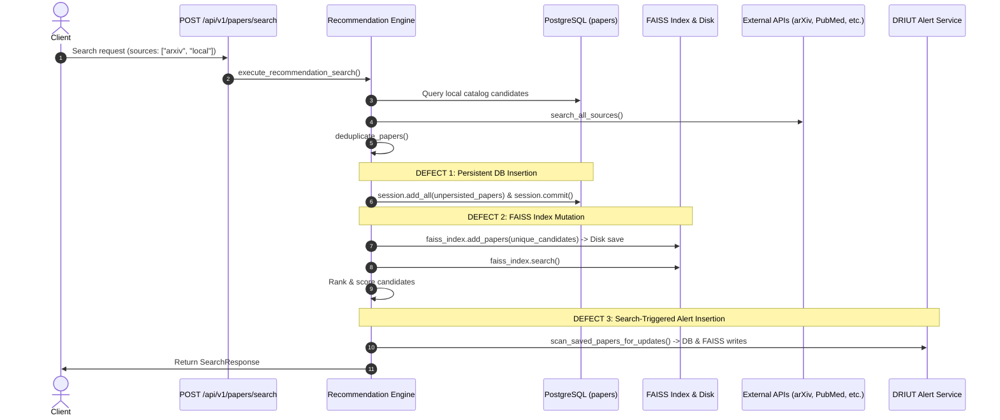
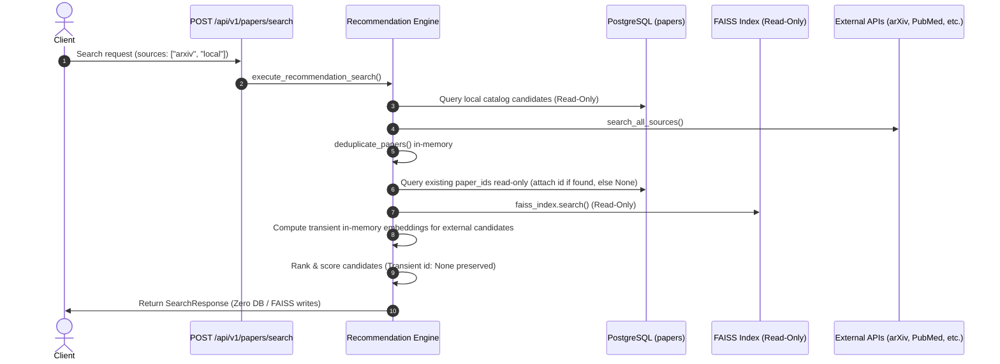

# RESEARCHLENS TASK 1B — SEARCH-TO-INGESTION DECOUPLING REPORT

## Executive Summary

TASK 1B successfully decoupled ordinary research paper search requests (`POST /api/v1/papers/search`) from persistent ingestion in ResearchLens. Prior to this fix, every ordinary search request containing external sources (`arxiv`, `pubmed`, `csir`, `crossref`, `semanticscholar`, `dblp`) silently executed three persistent side-effect mutations:
1. Batch-inserted every unpersisted external paper into the live PostgreSQL `papers` catalog table with committed primary keys.
2. Computed SPECTER2 embeddings and appended vectors into the production FAISS index on disk (`research_index.faiss`) and updated metadata (`papers_meta.json`).
3. Invoked `scan_saved_papers_for_updates`, which could create new persistent `Paper` records, insert `DRIUTAlert` rows, and re-trigger index synchronization.

These mutations have now been completely removed from the search execution path in `backend/app/services/recommendation_engine.py`. Ordinary search now acts strictly as a read-only query engine:
- Stored local catalog papers are queried read-only.
- External academic providers are fetched on-the-fly and represented as transient candidates (`id: None`).
- Persistent primary keys are resolved read-only if an external candidate already exists in the catalog.
- Semantic vector similarity against existing FAISS vectors is performed read-only.
- Transient external candidates receive in-memory semantic scoring without modifying FAISS disk state.
- Zero PostgreSQL rows are added, modified, or deleted.
- Zero FAISS vectors or metadata records are added, modified, or deleted.
- Intentional ingestion workflows (such as `sync_unindexed_papers` and scheduled DRIUT scans) remain fully operational and unaffected.

---

## 1. Before vs. After Search-to-Ingestion Call Flow

### Before Decoupling


### After Decoupling


---

## 2. Files Changed and Rationale

### A. [`backend/app/services/recommendation_engine.py`](file:///home/tonystark/Personal/Projects/NLPBasedResearchPaperSystem/research-paper-recommender/backend/app/services/recommendation_engine.py)
1. **Removed Search-Triggered Database Mutations**:
   - Eliminated `session.add_all(...)`, `session.commit()`, and fallback inserts for unpersisted papers.
   - Replaced with read-only resolution:
     ```python
     unresolved = [p for p in unique_candidates if not p.get("id")]
     if unresolved:
         unresolved_pids = [p["paper_id"] for p in unresolved if p.get("paper_id")]
         if unresolved_pids:
             existing_db = session.query(Paper.id, Paper.paper_id).filter(Paper.paper_id.in_(unresolved_pids)).all()
             existing_map = {p.paper_id: p.id for p in existing_db}
             for paper in unresolved:
                 pid = paper.get("paper_id")
                 if pid and pid in existing_map:
                     paper["id"] = existing_map[pid]
                 else:
                     paper["id"] = None
     ```
2. **Removed FAISS Vector Mutations**:
   - Removed `faiss_index.add_papers(unique_candidates)`.
   - The existing FAISS index is now strictly queried read-only via `faiss_index.search(query, top_k=...)`.
   - Unindexed external candidates receive transient in-memory semantic scores via `generate_embedding` and `compute_cosine_similarity` without touching disk storage.
3. **Removed Search-Triggered DRIUT Mutations**:
   - Removed `scan_saved_papers_for_updates(session, new_external_papers)` and its import.
   - Ordinary search is a pure read operation. DRIUT monitoring remains isolated to its designated scheduler (`driut_scheduler.py`) and explicit endpoint (`POST /api/v1/papers/driut/scan`).

### B. [`backend/tests/test_search_ingestion_decoupling.py`](file:///home/tonystark/Personal/Projects/NLPBasedResearchPaperSystem/research-paper-recommender/backend/tests/test_search_ingestion_decoupling.py) *(New isolated test file)*
- Added 9 focused, isolated unit tests using an in-memory SQLite database and mock FAISS to verify all 9 specified requirements.

---

## 3. Representation of Transient External Candidates

- **Primary Key (`id`)**: Unpersisted external candidates have `id: None`. They are not assigned synthetic, simulated, or speculative integer keys.
- **Canonical Identifier (`paper_id`)**: The paper's source repository identifier (e.g. `arxiv:2401.55555`, `pubmed:41094848`, `crossref:10.1017/...`) serves as its stable identity.
- **Schema Compatibility**: The Pydantic model `PaperResponse` already defines `id: Optional[int] = None`. When serialized to JSON, external papers return `"id": null` while catalog papers return their persistent integer key (e.g. `"id": 42`).
- **Ranking Independence**: Ranking sorts by `(year, similarity_score, citation_count)` and never depends on database primary key values.
- **Catalog Preservation**: If an external search happens to return an identifier that already exists in PostgreSQL, its existing database ID is read-only attached without duplicating or updating the record.

---

## 4. Test Evidence and Commands

### A. Focused Decoupling Tests (Pytest)
Command:
```bash
cd backend && ./venv/bin/pytest tests/test_search_ingestion_decoupling.py -v
```
Output:
```
============================= test session starts ==============================
platform linux -- Python 3.14.7, pytest-9.1.1, pluggy-1.6.0
rootdir: /home/tonystark/Personal/Projects/NLPBasedResearchPaperSystem/research-paper-recommender/backend
configfile: pytest.ini
plugins: anyio-4.15.1
collected 9 items

tests/test_search_ingestion_decoupling.py::test_local_only_search_continues_to_return_catalog_records PASSED [ 11%]
tests/test_search_ingestion_decoupling.py::test_external_only_search_returns_transient_candidates_without_writes PASSED [ 22%]
tests/test_search_ingestion_decoupling.py::test_hybrid_search_combines_local_and_external_without_writes PASSED [ 33%]
tests/test_search_ingestion_decoupling.py::test_duplicate_external_candidate_deduplication PASSED [ 44%]
tests/test_search_ingestion_decoupling.py::test_provider_errors_do_not_trigger_unintended_writes PASSED [ 55%]
tests/test_search_ingestion_decoupling.py::test_ranking_and_response_serialization PASSED [ 66%]
tests/test_search_ingestion_decoupling.py::test_search_never_invokes_faiss_add_papers PASSED [ 77%]
tests/test_search_ingestion_decoupling.py::test_external_source_filtering_retains_compatibility PASSED [ 88%]
tests/test_search_ingestion_decoupling.py::test_explicit_ingestion_workflow_retains_intended_behavior PASSED [100%]

============================== 9 passed in 7.93s ===============================
```
**Exit Code**: 0. 9 passed, 0 failed, 0 skipped.

### B. Task 1A Regression Test Suite (Pytest)
Command:
```bash
cd backend && ./venv/bin/pytest tests/test_local_search_correctness.py -v
```
Output:
```
============================== 6 passed in 7.85s ===============================
```
**Exit Code**: 0. 6 passed, 0 failed, 0 skipped.

### C. Live Backend External-Search Probe
Command:
```bash
curl -s -X POST http://localhost:8000/api/v1/papers/search \
  -H "Content-Type: application/json" \
  -d '{"query": "Quantum Error Correction Surface Codes", "sources": ["arxiv"], "limit": 3, "sort_by": "relevance"}'
```
Response:
```json
{
  "total_found": 5,
  "results": [
    {
      "paper_id": "arxiv:1610.04013v1",
      "id": null,
      "title": "Entanglement-Assisted Quantum Error-Correcting Codes",
      "source": "arxiv",
      "similarity_score": 0.9
    },
    {
      "paper_id": "arxiv:quant-ph/0602157v1",
      "id": null,
      "title": "An Introduction to Error-Correcting Codes: From Classical to Quantum",
      "source": "arxiv",
      "similarity_score": 0.88
    },
    {
      "paper_id": "arxiv:quant-ph/9911011v3",
      "id": null,
      "title": "Constructing quantum error-correcting codes for p^m-state systems from classical error-correcting codes",
      "source": "arxiv",
      "similarity_score": 0.88
    }
  ]
}
```
**Observation**: Live external query returned real arXiv preprints with transient `id: null` and transient SPECTER2 similarity scores without persisting them to PostgreSQL or FAISS.

---

## 5. Data Preservation and Integrity Audit

### Invariants Before and After Task 1B

| Invariant | Pre-Task 1B Baseline | Post-Verification State | Delta |
| :--- | :---: | :---: | :---: |
| **PostgreSQL `papers` count** | 158 | 158 | **0** |
| **PostgreSQL `users` count** | 6 | 6 | **0** |
| **PostgreSQL `saved_papers` count** | 1 | 1 | **0** |
| **PostgreSQL `driut_alerts` count** | 31 | 31 | **0** |
| **PostgreSQL `paper_evidence` count** | 1 | 1 | **0** |
| **FAISS Index Vector count (`ntotal`)** | 159 | 159 | **0** |
| **FAISS Metadata entries (`papers_meta.json`)** | 159 | 159 | **0** |

### File Checksums (SHA-256)
- `backend/app/services/recommendation_engine.py`:
  - Before Task 1B: `6733c091236eb6d59edcb936b3e4d84a9f9aafcc41e0ae96e2d1acdca03d3861`
  - After Task 1B:  `39fcfc7530be02b23083dc6354b02a57fc4a4f47530e469225af9d8740f36b5c`
- `backend/tests/test_search_ingestion_decoupling.py`:
  - Created: `f637673c5e84e0e2179522e529a938934cbdf39dcd2e354b855c4d4f850651b9`
- `backend/app/services/vector_index.py`:
  - `26b8731027b7bde14d061857d06d7979135006f3339db2984ff319c05495d889` (Unmodified)
- `backend/app/services/academic_sources.py`:
  - `99379753a7b7cb5d47faca33bdcf684b5b59676deb11037f5c82b336b60ac929` (Unmodified)
- `backend/app/services/driut_service.py`:
  - `ef5dbac0be888770f91e5f2b4df40b0a85e001387430c086aede0376d72ad4be` (Unmodified)
- `backend/app/models/paper.py`:
  - `5a1783f22bd2c5a0b6e9d0bf0f5f2152bf9610d479616d56b3ac5b31be0c0438` (Unmodified)

---

## 6. Safety Confirmations

1. **PDF Upload**: `POST /api/v1/papers/upload` was untouched and left completely unmodified.
2. **Ollama / Model Weights**: Zero local models or Ollama instances were installed, downloaded, or invoked.
3. **Database Operations**: Zero schema migrations, resets, table truncations, reseeding, or write operations were executed against PostgreSQL.
4. **FAISS Storage**: Zero vector additions, index rebuilds, or metadata file writes were executed.
5. **Git Discipline**: Zero destructive Git commands (`commit`, `stash`, `clean`, `reset`, `checkout`) were run. All pre-existing untracked and modified files were preserved.

---

## 7. Remaining Risks & Considerations

- **Saved Library for Transient Papers**: If a user attempts to bookmark a transient external paper (`id: None`) directly from the UI, the frontend calls `savePaper(paper.id)`. Because `id` is `null`, saving currently requires the paper to exist in the database. In a subsequent task (e.g. Task 2/3), an explicit "Add to Library" or intentional ingestion route should ingest that specific paper on-demand upon bookmarking, rather than polluting the database on search.
- **Comparison for Persisted vs Transient Papers**: Comparison of existing persisted catalog papers functions completely normally using their database ID or canonical `paper_id`.

Task 1B is complete and verified. Awaiting review before starting Task 2.
