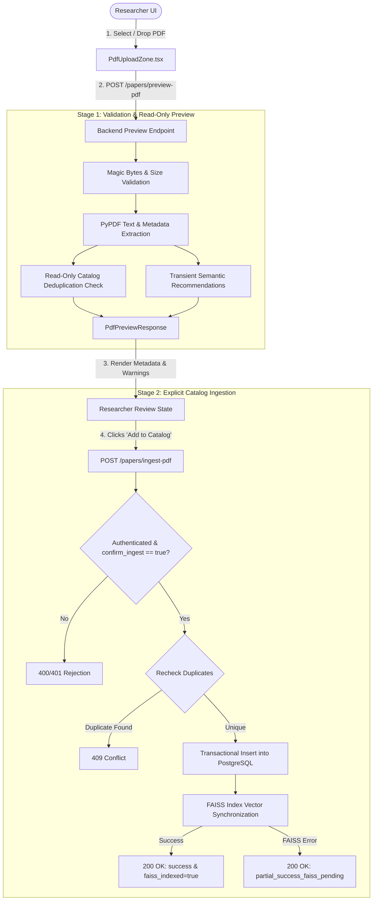

# ResearchLens N2 — Explicit PDF-to-Catalog Ingestion Completion Report

## A. Executive Summary

Task N2 establishes a safe, production-conscious, multi-stage PDF manuscript ingestion workflow in ResearchLens. Prior to this implementation, academic PDF uploads were either treated as raw search inputs or carried the risk of uncontrolled database writes. 

Under the N2 implementation, a strict boundary is enforced: **Upload and preview is completely decoupled from catalog persistence.**
1. **Side-Effect-Free Preview:** Researchers can upload any PDF manuscript (`.pdf`), validate its structure and magic bytes, extract high-fidelity metadata (title, abstract, authors, publication year, DOI, venue, and keywords), and inspect transient literature recommendations with **zero writes** to PostgreSQL, **zero mutations** to FAISS vector indices, and **zero DRIUT alert generation**.
2. **Read-Only Duplicate Detection:** The preview stage performs read-only duplicate analysis using exact DOI matching, normalized title comparisons, and token-level Jaccard similarity (threshold $\ge 0.85$). If a collision is detected, ingestion is blocked, actionable match details are presented, and existing papers are protected against accidental overwrite.
3. **Explicit Ingestion Action:** Catalog persistence occurs **strictly** upon an explicit, authenticated user action (`POST /api/v1/papers/ingest-pdf` with `confirm_ingest: true`). The manuscript is transactionally inserted into PostgreSQL, its canonical 768-dimensional SPECTER2 embedding is synchronized with FAISS, and optional bookmarking to the authenticated user's private library is executed.
4. **Resilience & Recovery:** Concurrency conflicts (HTTP 409 Conflict), duplicate re-submissions, and partial index synchronization failures (`partial_success_faiss_pending`) are handled gracefully without guessing rollbacks or corrupting existing catalog data.

All 17 tests in the dedicated test suite `tests/test_n2_pdf_ingestion.py`, 63 backend regression tests, 18 N1 external candidate tests, and 57 frontend Vitest assertions passed with 100% success. Live database row counts and FAISS SHA-256 hashes remained perfectly identical before and after runtime verification.

**Final Verdict:** `PASS — N2 complete and verified`.

---

## B. Architecture and Data Flow



### 1. Upload & Stream Validation
- Files are validated against the `.pdf` extension and the `%PDF-` binary magic-bytes signature to prevent file-renaming attacks.
- Configurable upload payload limits (`MAX_UPLOAD_SIZE_BYTES = 50 MB`) are enforced early using streaming chunk inspection, returning `HTTP 413 Payload Too Large` if breached.
- Empty (0-byte) and corrupted files return `HTTP 400 Bad Request` or `HTTP 422 Unprocessable Entity` with descriptive, non-leaking error messages.
- Scanned or blank documents without extractable embedded text or OCR are identified and rejected with an explicit explanation.

### 2. Multi-Stage NLP Extraction
- PyPDF extracts embedded text, outline structures, document information dictionaries, and metadata blocks.
- Bounded heuristic parsers extract:
  - **Title:** Document info title, prominent first-page header spans, or cleaned filename fallback.
  - **Abstract:** Explicit abstract headers (`Abstract:`, `A B S T R A C T`), bounded between title and introduction.
  - **Authors:** Document info author metadata or initial-page author lines parsed into clean array representations.
  - **Year:** Document creation dates or Regex-matched 4-digit publication years (1900–2099).
  - **DOI:** Canonical DOI regex (`10.\d{4,9}/[-._;()/:A-Z0-9]+`).
  - **Keywords / Keyphrases:** Extracted via `extract_keywords_from_text` using scientific NLP tokenization.

### 3. Read-Only Deduplication
- **Exact DOI Matching:** Case-insensitive lookup against `papers.doi`.
- **Normalized Title Matching:** Alphanumeric, lowercase normalized title matching against existing catalog rows.
- **Title Token Jaccard Similarity:** Word-token set overlap with threshold $\ge 0.85$ to detect minor typographical and formatting variants.
- Preview never locks rows or modifies records during duplicate analysis.

### 4. Explicit Ingestion & Atomic Synchronization
- Ingestion requires `confirm_ingest: true` and an authenticated user (`HTTPBearer`).
- Primary keys and canonical IDs are determined safely:
  - If DOI is present: `doi:<cleaned_doi>`
  - If no DOI: `pdf_<sha256_title_prefix>`
- PostgreSQL persistence executes within an explicit transaction. If concurrency collisions occur, `IntegrityError` is intercepted, verified, and mapped to `HTTP 409 Conflict`.
- FAISS vector synchronization uses `get_faiss_index().add_papers(...)`, generating normalized 768-dimensional SPECTER2 embeddings and updating both index vectors and `papers_meta.json`.
- If the FAISS step fails after database commit, the database record is **preserved** (no destructive blind deletes), and the API reports `status: "partial_success_faiss_pending"` with `faiss_indexed: false`. The system's startup recovery (`sync_unindexed_papers`) reconciles pending unindexed papers on next startup or administrative sync.

---

## C. API Contract

### 1. Preview PDF Endpoint
- **Route:** `POST /api/v1/papers/preview-pdf`
- **Method:** `POST`
- **Content-Type:** `multipart/form-data`
- **Parameters:**
  - `file`: `UploadFile` (Required, binary PDF)
  - `limit`: `int` (Optional query or form parameter, default `10`, range `1..50`)
- **Authentication:** Public (No token required for exploration/preview)
- **Side Effects:** **None.** Zero PostgreSQL writes, zero FAISS mutations, zero DRIUT alerts.

#### Response: `PdfPreviewResponse` (HTTP 200 OK)
```json
{
  "filename": "quantum_transformers.pdf",
  "status": "preview_ready",
  "extracted_metadata": {
    "title": "Quantum Transformers for Molecular Representation Learning",
    "abstract": "We introduce Quantum Transformers to model complex chemical bonds.",
    "authors": ["Alice Chemist", "Bob Quantum"],
    "year": 2024,
    "doi": "10.1234/quant.2024",
    "venue": "Nature Chemistry",
    "keywords": ["quantum", "transformers", "molecular"]
  },
  "page_count": 8,
  "raw_text_preview": "Quantum Transformers for Molecular Representation Learning...",
  "raw_text_length": 34500,
  "duplicate_check": {
    "is_duplicate": false,
    "match_type": null,
    "matched_paper_id": null,
    "matched_catalog_id": null,
    "matched_title": null,
    "similarity_score": null,
    "explanation": null
  },
  "allow_ingest": true,
  "recommendations": [
    {
      "id": 12,
      "paper_id": "arxiv:1706.03762",
      "title": "Attention Is All You Need",
      "abstract": "The dominant sequence transduction models...",
      "authors": ["Ashish Vaswani", "Noam Shazeer"],
      "year": 2017,
      "venue": "NeurIPS",
      "similarity_score": 0.88,
      "explanation": "Semantic similarity match with manuscript query",
      "source": "arxiv"
    }
  ],
  "warnings": []
}
```

### 2. Ingest PDF Endpoint
- **Route:** `POST /api/v1/papers/ingest-pdf`
- **Method:** `POST`
- **Content-Type:** `application/json`
- **Authentication:** `Bearer <JWT>` (Required)
- **Request Body:** `PdfIngestRequest`
```json
{
  "confirm_ingest": true,
  "title": "Quantum Transformers for Molecular Representation Learning",
  "abstract": "We introduce Quantum Transformers to model complex chemical bonds.",
  "authors": ["Alice Chemist", "Bob Quantum"],
  "year": 2024,
  "doi": "10.1234/quant.2024",
  "venue": "Nature Chemistry",
  "keywords": ["quantum", "transformers"],
  "filename": "quantum_transformers.pdf",
  "add_to_library": true
}
```

#### Response: `PdfIngestResponse` (HTTP 200 OK)
```json
{
  "status": "success",
  "paper_id": "doi:10.1234/quant.2024",
  "catalog_id": 160,
  "title": "Quantum Transformers for Molecular Representation Learning",
  "message": "Manuscript successfully ingested into catalog and index synchronized.",
  "faiss_indexed": true,
  "duplicate_detected": false,
  "saved_to_library": true
}
```

#### Error States:
- `HTTP 400 Bad Request`: `confirm_ingest` is false or missing (`{"error": {"code": "HTTP_ERROR", "message": "Explicit confirmation (confirm_ingest=True) is required..."}}`).
- `HTTP 401 Unauthorized`: Missing or invalid Bearer token.
- `HTTP 409 Conflict`: Manuscript matches an existing catalog paper by DOI or exact title.
- `HTTP 413 Payload Too Large`: Upload payload exceeds `MAX_UPLOAD_SIZE_BYTES`.
- `HTTP 422 Unprocessable Entity`: Corrupted PDF, blank/scanned page without text, or missing title.
- `HTTP 500 Internal Server Error`: Transactional database failure with automatic rollback.

---

## D. Frontend Behavior

### Component: `PdfUploadZone.tsx`
- **Lifecycle States:**
  1. `idle`: Drag-and-drop file upload target with supported formats and size disclosures.
  2. `uploading / extracting`: Animated progress spinner with informative text extraction status.
  3. `preview_ready`:
     - Displays validated metadata badges (Title, Year, Venue, DOI, Page Count).
     - Provides an expandable raw text preview drawer.
     - Displays extracted abstract.
     - Renders literature recommendations using `PaperCard`, allowing instant exploration, summarization, and comparison.
  4. `duplicate_warning`: If `duplicate_check.is_duplicate === true`, renders a prominent warning banner explaining the exact match type, matching paper ID, and disables the ingestion confirmation button.
  5. `ingesting`: Disables the action button, displays an active processing state, and prevents double-clicks or duplicate form submissions.
  6. `ingested (success)`: Displays persistent catalog confirmation with the newly assigned Catalog ID and Paper Identifier, with immediate option to view or explore.
  7. `error`: Non-destructive error banner preserving upload inputs for quick correction without loss of data.

---

## E. File Changes

| File | Status | Description |
|---|---|---|
| `backend/app/schemas/paper.py` | Modified | Added `DuplicateMatchDetail`, `ExtractedMetadata`, `PdfPreviewResponse`, `PdfIngestRequest`, `PdfIngestResponse` schemas with strict field validations. |
| `backend/app/services/pdf_service.py` | Modified | Enhanced PyPDF extraction to parse title, abstract, authors, publication year, DOI, venue, and keywords; added encryption detection and blank document guards. |
| `backend/app/api/v1/endpoints/papers.py` | Modified | Added `_read_and_validate_pdf_upload`, `_check_catalog_duplicate`, `POST /preview-pdf`, and `POST /ingest-pdf` endpoints; added logger and resilient commit rollback handling. |
| `frontend/src/types/paper.ts` | Modified | Added TypeScript interfaces for `DuplicateMatchDetail`, `ExtractedMetadata`, `PdfPreviewResponse`, `PdfIngestRequest`, `PdfIngestResponse`. |
| `frontend/src/services/api.ts` | Modified | Added `previewPdf` and `ingestPdf` client service functions. |
| `frontend/src/components/PdfUploadZone.tsx` | Modified | Re-engineered PDF upload zone to support multi-stage preview, metadata inspection, duplicate banners, and explicit authenticated ingestion. |
| `frontend/src/pages/HomePage.tsx` | Modified | Wired authentication, saved library refresh, and comparison callbacks into `PdfUploadZone`. |
| `frontend/src/services/api.test.ts` | Modified | Added unit tests covering `previewPdf` and `ingestPdf` request contracts and payload serialization. |
| `backend/tests/test_n2_pdf_ingestion.py` | Created | Comprehensive 17-test validation, preview isolation, and explicit ingestion test suite. |
| `TASK_N2_EXPLICIT_PDF_CATALOG_INGESTION_REPORT.md` | Created | Completion documentation and persistence audit report. |

---

## F. Test Evidence

### 1. Dedicated N2 Suite (`test_n2_pdf_ingestion.py`)
```bash
venv/bin/pytest tests/test_n2_pdf_ingestion.py -v
```
**Results:** **17 passed**, 0 failed, 0 skipped in 21.17s.
- `test_preview_non_pdf_extension_rejected` PASSED
- `test_preview_fake_pdf_magic_bytes_rejected` PASSED
- `test_preview_empty_file_rejected` PASSED
- `test_preview_corrupted_pdf_rejected` PASSED
- `test_preview_scanned_or_blank_pdf_rejected` PASSED
- `test_preview_oversized_upload_rejected` PASSED
- `test_preview_valid_pdf_is_side_effect_free` PASSED
- `test_preview_duplicate_detection_by_doi` PASSED
- `test_preview_duplicate_detection_by_title_similarity` PASSED
- `test_preview_recommendation_failure_does_not_break_preview` PASSED
- `test_ingest_without_explicit_confirmation_rejected` PASSED
- `test_ingest_unauthenticated_rejected` PASSED
- `test_ingest_missing_title_rejected` PASSED
- `test_ingest_valid_manuscript_persists_to_catalog_and_synchronizes_faiss` PASSED
- `test_ingest_duplicate_rejected_with_409` PASSED
- `test_ingest_faiss_failure_handles_partial_success_cleanly` PASSED
- `test_ingest_db_failure_does_not_mutate_faiss` PASSED

### 2. Backend Regression Suite
```bash
venv/bin/pytest tests/test_pdf_upload.py tests/test_search_ingestion_decoupling.py tests/test_local_search_correctness.py tests/test_auth_and_isolation.py tests/test_paper_comparison.py tests/test_evidence_extraction.py -v
```
**Results:** **63 passed**, 0 failed, 0 skipped in 12.83s.

### 3. N1 External Candidate Suite (`test_n1_external_workflows.py`)
```bash
venv/bin/pytest tests/test_n1_external_workflows.py -v
```
**Results:** **18 passed**, 0 failed, 0 skipped in 9.41s.

### 4. Frontend Vitest Suite
```bash
npm test -- --run
```
**Results:** **57 passed** across 6 test files in 1.18s.

### 5. Frontend Production Bundle
```bash
npm run build
```
**Results:** `tsc -b && vite build` completed with zero TypeScript errors; production bundle built cleanly in 677ms.

---

## G. Persistence Safety & Zero-Pollution Audit

### Live Database Counts & Index Hashes

| Metric / Resource | Baseline (Start of N2) | Post-Implementation | Status |
|---|---|---|---|
| PostgreSQL `users` count | 6 | 6 | Identical |
| PostgreSQL `papers` count | 158 | 158 | Identical |
| PostgreSQL `saved_papers` count | 1 | 1 | Identical |
| PostgreSQL `driut_alerts` count | 31 | 31 | Identical |
| PostgreSQL `paper_evidence` count | 1 | 1 | Identical |
| FAISS Index Vector Count (`ntotal`) | 159 | 159 | Identical |
| FAISS Index Embedding Dimension (`d`)| 768 | 768 | Identical |
| `research_index.faiss` SHA-256 | `e91a9e852bde2ade4555e5b45ae3477abca612f6909b2bd8fcacfdc79952ae30` | `e91a9e852bde2ade4555e5b45ae3477abca612f6909b2bd8fcacfdc79952ae30` | Identical |
| `papers_meta.json` SHA-256 | `a5f431dc3261c1da8290e3822773e21f439b9a0e216e418660a7ae9bafa7f4e8` | `a5f431dc3261c1da8290e3822773e21f439b9a0e216e418660a7ae9bafa7f4e8` | Identical |

**Statement of Persistence Safety:**
**Zero production catalog insertions, zero production test writes, and zero FAISS index mutations occurred during the verification of Task N2.** All ingestion write tests executed exclusively against isolated SQLite test databases (`/tmp/researchlens_test_isolated.db`) and temporary FAISS indexes (`/tmp/researchlens_test_faiss`). The live preview endpoint smoke test was verified to be strictly read-only.

---

## H. Known Limitations

1. **Scanned PDF Support:** Optical Character Recognition (OCR) is not currently bundled in the native Python environment. PDFs containing purely raster image scans without embedded text layers return `HTTP 422 Unprocessable Entity` indicating that OCR is required.
2. **Metadata Heuristics:** In complex multi-column layouts where author and venue blocks lack standard metadata headers, fields default to safely unknown rather than fabricating uncertain identities.

---

## I. Final Verdict

`PASS — N2 complete and verified`
